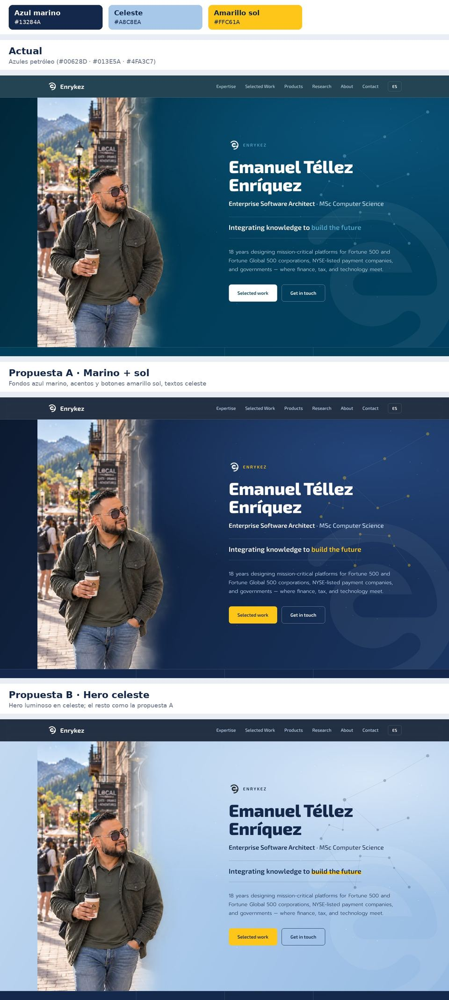

# Diseño visual — enrykez.com

> **Estado:** paleta **A · Marino + sol** aplicada el 3 de noviembre de 2026.
> Este documento guarda la decisión, la alternativa descartada (B) y las reglas para usar la paleta sin degradarla con el tiempo.

## 1. Paleta

| Rol | Nombre | Hex | Token CSS |
|---|---|---|---|
| Base / fondos oscuros / texto principal | **Azul marino** | `#13284A` | `--brand`, `--brand-deep`, `--ink` |
| Fondo más profundo (nav, footer, banner) | Marino profundo | `#0C1A30` | `--brand-abyss` |
| Suavizar: texto sobre oscuro, tintes claros | **Celeste** | `#A8C8EA` | `--celeste` |
| Calor y acción: botones, acentos | **Amarillo sol** | `#FFC61A` | `--sol` (`--brand-glow` apunta al mismo valor) |
| Hover del amarillo | Sol claro | `#FFD65C` | `--sol-hover` |
| Fondo claro principal | Papel | `#F6F9FD` | `--paper` |
| Fondo claro alterno (tinte celeste) | Papel celeste | `#E6EEF9` | `--paper-2` |
| Texto de cuerpo / atenuado / líneas | — | `#2E3F5C` / `#5B6B86` / `#D4E1F1` | `--text` / `--muted` / `--line` |

Origen: referencia de colorimetría «azul marino + celeste + amarillo sol». El marino da seriedad, el celeste suaviza y el amarillo aporta calidez.

Los tokens viven en `:root` de `index.html` y de `assets/css/legal.css`; `404.html` y `assets/css/consent.css` usan los mismos valores literales (son autónomos). **Cualquier cambio de paleta se hace ahí y en este documento.**

## 2. Reglas de uso

1. **El amarillo nunca es texto sobre fondo claro.** Amarillo sobre blanco: 1.6:1 (ilegible). Solo se usa como fondo de botón con texto marino, como acento sobre marino o en elementos decorativos (líneas de *kicker*, viñetas).
2. **Un solo acento amarillo protagonista por pantalla.** En el hero: el botón principal y «build the future». Las etiquetas secundarias van en celeste (eyebrow «ENRYKEZ», categorías de proyectos).
3. **Botón primario = amarillo con texto marino** (`.btn-primary`, `.btn-brand`, `.btn` en páginas legales). Botón secundario = contorno.
4. **Foco de teclado:** anillo amarillo con halo marino (`outline` + `box-shadow`), visible sobre fondos claros y oscuros. No sustituirlo por un solo color.
5. **Excepción deliberada:** en el banner de cookies, «Accept» se mantiene blanco y no amarillo, para no inducir la aceptación con más énfasis visual que «Decline».
6. **Guiños personales:** la constelación de Acuario usa estrellas amarillas y líneas celestes sobre marino (cielo nocturno). Mantenerlos discretos (ver README).

### Contraste verificado (WCAG 2.x)

| Combinación | Ratio | Nivel |
|---|---|---|
| Marino `#13284A` sobre papel `#F6F9FD` | 13.9:1 | AA |
| Cuerpo `#2E3F5C` sobre papel | 10.0:1 | AA |
| Atenuado `#5B6B86` sobre papel celeste `#E6EEF9` | 4.6:1 | AA |
| Blanco sobre marino | 14.7:1 | AA |
| Celeste sobre marino | 8.5:1 | AA |
| Amarillo sobre marino / marino sobre amarillo | 9.3:1 | AA |
| Amarillo sobre blanco | 1.6:1 | **Prohibido como texto** |

## 3. Decisión (registro)

| | A · Marino + sol ✅ elegida | B · Hero celeste (descartada) |
|---|---|---|
| Hero | Fondo marino, texto blanco, «build the future» en amarillo | Fondo celeste luminoso, texto marino, «build the future» subrayado en amarillo |
| Resto del sitio | Igual en ambas | Igual en ambas |
| Carácter | Sobrio, ejecutivo, con calidez en acentos | Fresco y cercano, ruptura visual mayor |

**Motivos de la elección:** (1) encaja con el posicionamiento de Enterprise Architect y sistemas de misión crítica; (2) la constelación de Acuario conserva su lectura de cielo nocturno; (3) contraste más robusto. **Cuándo reconsiderar B:** si el sitio busca un tono más cercano o de producto de consumo, o en una campaña concreta.



### Receta de la variante B (para reproducirla)

Añadir al final del `<style>` de `index.html`:

```css
.hero{background:radial-gradient(120% 90% at 82% 15%,#D6E6F7 0%,transparent 55%),
  linear-gradient(120deg,#C3D9F1 0%,#A8C8EA 55%,#97BBE2 100%);color:#13284A}
.hero h1{color:#13284A}
.hero .role,.hero p.pitch{color:#2E3F5C} .hero .role b{color:#13284A}
.slogan{color:#13284A;border-color:rgba(19,40,74,.22)}
.slogan .accent{color:#13284A;background:linear-gradient(transparent 58%,#FFC61A 58%,#FFC61A 92%,transparent 92%)}
.hero-eyebrow span{color:#13284A} .hero-eyebrow img{filter:brightness(0);opacity:.8}
.hero-net g:nth-of-type(2){stroke:rgba(19,40,74,.22)}
.hero-net .aq-stars{fill:rgba(19,40,74,.55)} .hero-net .sky{fill:rgba(255,255,255,.7)}
.btn-ghost{border-color:#13284A;color:#13284A}
```

## 4. Logotipo — Brand Kit v2

Desde noviembre de 2026 el sitio usa el **Brand Kit v2** de Enrykez (logo en color sobre fondo transparente). La fuente maestra vive fuera del repositorio; aquí solo hay copias con sus nombres originales.

| Ubicación | Fondo real (CSS computado) | Asset |
|---|---|---|
| Nav, hero (eyebrow y marca de agua), banda «hybrid», footer, 404, encabezado de páginas legales | Oscuro (`#0C1A30`–`#24457A`) | `assets/enrykez-isotipo-negativo.svg` |
| Marca de agua de la foto *About* | Claro (`#E6EEF9`) | `assets/enrykez-isotipo-positivo.svg` |
| Favicon, apple-touch-icon, iconos PWA | — | Raíz: `favicon.*`, `icon-*.png`, `site.webmanifest` |

**Reglas:** elegir la variante por el fondo, nunca recolorear con `filter`, nunca poner el logo dentro de un círculo o recuadro de color; dimensionar por altura (proporción 0.889:1) y declarar `width`/`height` para evitar saltos de maquetación. La opacidad reducida solo se permite en las dos marcas de agua decorativas.

**Pendientes:**
- `assets/og-enrykez.jpg` aún contiene el símbolo anterior (blanco) — regenerar con el Brand Kit v2.
- Eliminar, en un commit posterior, `assets/enrykez-symbol-white.png`, `enrykez-symbol-brand.png`, `enrykez-symbol-gray.png`, `assets/favicon.ico`, `assets/favicon-32.png` y `assets/apple-touch-icon.png` (ya sin referencias en el código).
- **Coherencia de color:** el Azul Enrykez del kit (`#00628D`, logo positivo y favicon) no coincide con el marino `#13284A` del sitio, y el amarillo sol no forma parte de la paleta del kit. Decidir si la paleta del sitio es una paleta digital derivada (documentar la relación) o si se alinea con el kit.
